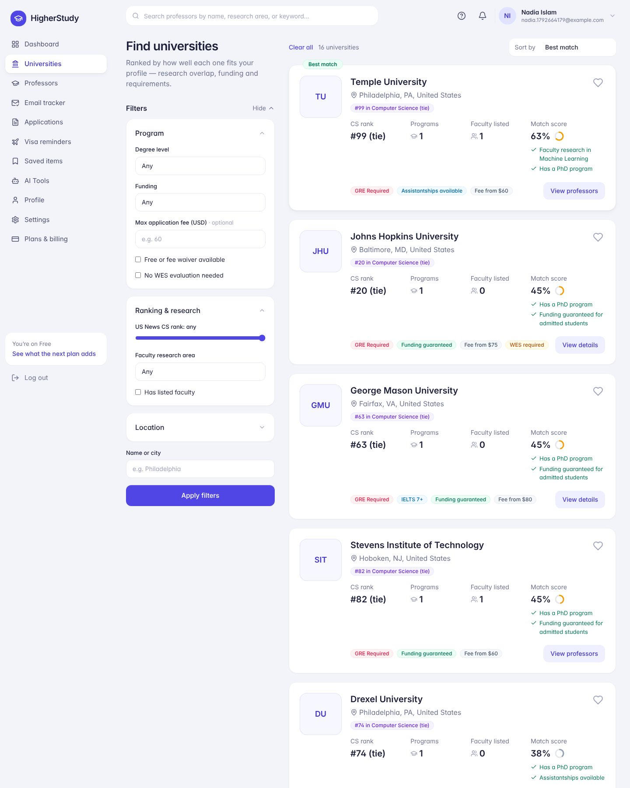

# HigherStudy

Discovery and workflow platform for students applying to Master's, PhD and PostDoc programs abroad:
university and professor search, cold-email outreach tracking, an application Kanban, self-service
visa reminders, bKash/Nagad subscriptions, and a three-tier admin console.

- **API** — NestJS 10 · Prisma 5 · PostgreSQL 16 (pg_trgm + tsvector) · Redis cache-aside · BullMQ worker
- **Web** — Next.js 14 (App Router) · Tailwind, styled after the supplied mockups



## Quick start

### Docker (everything)

```bash
cp .env.example .env            # set JWT_SECRET
docker compose up --build -d
docker compose exec api npx prisma migrate deploy
docker compose exec api npx prisma db seed
open http://localhost:3000
```

### Local dev

Needs Node 20+, Postgres 16 and Redis 7 running locally.

```bash
cp .env.example .env && cp .env.example apps/api/.env
npm install
npm run db:migrate && npm run db:seed
npm run dev:api      # http://localhost:4000/api/v1
npm run dev:worker   # background jobs
npm run dev:web      # http://localhost:3000
```

### Deploying

Railway (Docker images, managed Postgres + Redis): see [docs/DEPLOY_RAILWAY.md](docs/DEPLOY_RAILWAY.md).

### Logins (password `Password123!`)

Seeded from `apps/api/prisma/seed-data/*.csv` (the HigherStudy spreadsheet export — see
[docs/DATA_NOTES.md](docs/DATA_NOTES.md) for what the export lost and how values are read).

| Email | Role | Plan |
|---|---|---|
| `ahmed.rahman@buet.ac.bd` | Student (GU) | Starter (as in the CSV — upgrade to Pro to see his visa reminder) |
| `admin.support@higherstudy.bd` | Admin | — |
| `ceo@higherstudy.bd` | Super Admin | — |

The CSV had placeholder password hashes, so the seed sets them from `SEED_PASSWORD`
(default `Password123!`, required in production).

Payments run in **mock mode** by default: checkout opens a test page where you choose success or
failure. See [docs/PAYMENTS.md](docs/PAYMENTS.md) to switch to bKash.

## What's in the box

| Area | Screens | API |
|---|---|---|
| Student | Dashboard, Find Universities, Professors at a university, Professor search, Professor profile, Email Tracker (+ thread timeline), Application Tracker (drag-and-drop Kanban + full form), Visa Reminders, Saved Items, Profile (6 tabs), Settings & billing history, Purchase Plan | `/universities`, `/professors`, `/outreach`, `/applications`, `/visa-reminders`, `/profile`, `/dashboard`, `/saved`, `/payments` |
| Admin | Overview, Users (plan changes, offline payments, disable/delete), Reconcile Payments, Directory (universities & professors), CSV Import | `/admin/*` |
| Super Admin | Transaction History (status/gateway/date filters), Audit Trail, Staff & Roles | `/superadmin/*` |
| Worker | — | Outreach follow-ups (7 days), visa milestones (14/7/1 days), plan expiry |

New screens beyond the mockups: Visa Reminders, Saved Items, Settings, all admin/super-admin
screens, login/register, a checkout page and a mock gateway page.

**CSV import (Admin and Super Admin).** *Admin → CSV Import* bulk-adds or updates universities,
programs and professors. Download a template, upload the file, review the preview (new /
updated with old → new values / unchanged / errors / warnings), then confirm. Nothing is written
until you confirm; the commit runs in one transaction, purges the directory caches, and is
recorded in the import history and audit trail. Rows are matched on `id` when given, otherwise
on name (universities), university + program + degree (programs) or university + email/name
(professors); `university_id` accepts an id or the exact university name. Rows with errors can
be skipped with "Import the valid rows". List columns (`research_areas`) take `A; B`, `A | B`, `A, B` or an array such as `["A", "B"]`.
Limits: 2 MB, 5,000 rows, UTF-8. The seed uses the same
row parsers, so a file that seeds also imports. Users and transactions can't be imported —
those need password and payment-approval decisions first.

**First-run setup and guided tours.** A new student signs up, then completes a 3-step profile
setup (about you, studies, goals) before anything else opens — the API answers
`403 PROFILE_SETUP_REQUIRED` on every other student endpoint until it's done. Each student
screen then shows a short spotlight tour the first time it's opened (replay any time with the
? button, or "Show tips again" in Settings). When a feature ships, or a plan upgrade unlocks
one, its menu item shows a **New** / **Unlocked** badge and the dashboard lists it under "New for
you"; opening it runs that feature's own tour. Tour and highlight state is stored per account, so
it follows the student across devices. Accounts that existed before this release skip setup.

**Sign-in and sessions.** Short-lived access tokens (15 min, kept only in the page's memory)
plus a rotating refresh token in an httpOnly, SameSite=Lax cookie. Each sign-in is a server-side
session: replaying an old refresh token ends that session (theft detection), logout and "sign out
everywhere" take effect on the next request, a password change signs out other devices, and a
disabled account is signed out immediately. Five wrong passwords lock an account for 15 minutes.
The browser only talks to the web origin — `/api/v1/*` is proxied to the API by the web app — so
the cookie stays first-party on any hosting. Settings shows signed-in devices and password change.
In production the API refuses a missing, short or example `JWT_SECRET`.

**Design.** "Softer indigo": the indigo brand stays, on a cool lavender-grey canvas with
indigo-slate text, hairline borders, larger radii, sentence-case labels, skeleton loading states
and toasts for confirmations. Tokens live in `apps/web/tailwind.config.ts`; components in
`apps/web/src/components/ui.tsx`.

**Purchase Plan.** Subscription-style plan page: current plan and usage, four plan cards with a
recommended plan chosen from the student's usage (e.g. near the application cap → next tier),
a feature comparison table, and billing FAQs. Upgrading goes to a checkout page that shows what
changes right away, the 12-month term, access-until date and gateway choice (Nagad shown as
unavailable until it's configured). After payment the page confirms what was unlocked.

## Repository layout

```
apps/
  api/
    prisma/            schema.prisma · migrations/ (1 tables · 2 search · 3 CHECK constraints)
                       seed.ts · seed-data/*.csv
    src/common/        guards, decorators, Redis cache, audit log, mailer, plan limits,
                       derive.ts (text → filterable columns, match score), checklist.ts, csv.ts
    src/modules/       auth · universities · programs · professors · outreach · applications · visa
                       student (profile, dashboard, saved, notifications) · payments · admin
    src/workers/       job bodies;  src/worker.ts = BullMQ process
    test/smoke.sh      155-check end-to-end test against a running API seeded from the CSVs
  web/
    src/app/(auth)     login, register
    src/app/(app)      every authenticated screen
    src/components/    shell (sidebar/topbar), UI kit, application form, professor browser …
docs/
  ARCHITECTURE.md      pipeline, RBAC matrix, cache keys/TTLs, indexes, API reference
  STREAMS.md           parallel work streams, contracts between them, next tasks
  PAYMENTS.md          checkout flow, reconciliation, gateway status
  DATA_NOTES.md        seed data: lost columns, interpretation rules, known inconsistencies
  screenshots/
```

The build is split into independent work streams (database, API core, student modules,
admin & workers, web UI) — see [docs/STREAMS.md](docs/STREAMS.md) for ownership and contracts.

## Testing

```bash
npm run typecheck                       # API + web
npm test                                # API unit tests (56 tests: guards incl. the setup gate, auth secrets/tokens/cookies, cache keys, CSV, derivations, import rows, checklist)
API=http://localhost:4000/api/v1 ./apps/api/test/smoke.sh   # needs a freshly seeded DB
```

The smoke test runs against the CSV data: logins for the seeded users, RBAC, the match ranking
(Stevens 100%), every university filter, spelling-insensitive tag search, fit sorting, the
seeded outreach timelines and Dhaka timestamps, program-driven document checklists, duplicate
protection, plan gating of the seeded visa reminder, payments and reconciliation, derived
columns on admin writes, cache purges, role changes, CSV import (preview, partial commit,
expired previews, cache purge, history, audit), the subscription endpoint, and onboarding (setup
gate for new sign-ups, validation, tours, feature highlights by plan), and sessions (cookie flags,
rotation, theft detection, logout, sign-out everywhere, password change, lockout, alg=none,
disabled accounts).

## Known gaps

- **Seed data gaps:** program deadlines/catalog links and professor links/metrics were lost in
  the spreadsheet export — see [docs/DATA_NOTES.md](docs/DATA_NOTES.md).
- **Nagad** checkout is a stub (needs merchant keys); **bKash** is implemented but unverified
  against a live merchant account.
- Attachments are stored as filenames/URLs; there's no file upload service yet.
- AI Tools is a placeholder page.
- Application plan caps check then insert, so two simultaneous creates could exceed the cap by one.
- Prisma 6+ renames the `fullTextSearch` preview feature to `fullTextSearchPostgres`.
