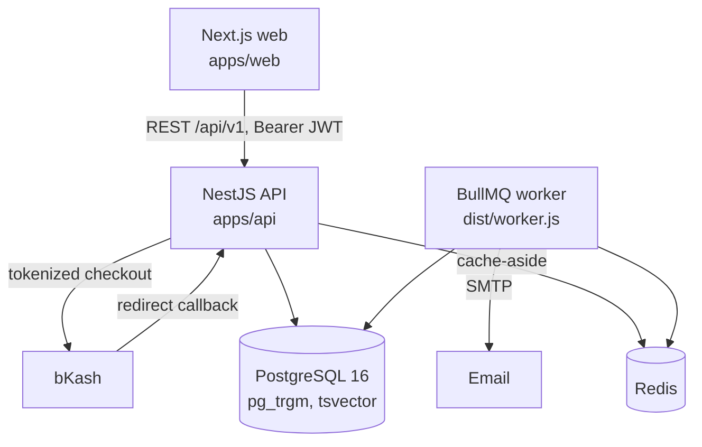

# Architecture



Two Node processes ship from `apps/api`: the HTTP API (`main.ts`) and the background worker
(`worker.ts`). Scale them independently.

## Request pipeline

Global guards run in this order on every route:

1. `ClientIpThrottlerGuard` — 300 req/min per client IP; login 10/min, register 5/min. The IP
   comes from the web proxy's `X-HS-Client-IP` (trusted only with `PROXY_SECRET`) or `req.ip`
   (honours `TRUST_PROXY`).
2. `JwtAuthGuard` — verifies the token (HS256 pinned, issuer/audience checked), rejects it if its
   session (`sid`) was revoked (Redis marker, Postgres fallback), then loads **role and plan from
   Redis** (`hs:user:role:v2:<id>`, 1h TTL) with Postgres as fallback. The token only carries
   `sub` + `sid`, so a role or plan change is enforced on the very next request once the key is evicted.
3. `RolesGuard` — `@Roles('ADMIN','SUPER_ADMIN')` etc.
4. `PlanGuard` — `@RequiresPlan('PRO')`; admins bypass.
5. `SetupGuard` — a new student who hasn't finished profile setup only reaches `@AllowBeforeSetup()` routes.

## RBAC matrix

| Capability | GU | ADMIN | SUPER_ADMIN |
|---|:-:|:-:|:-:|
| Search universities / professors (read-only directory) | ✓ | ✓ | ✓ |
| Own outreach, applications, visa reminders, saved items, profile | ✓ (own only) | — | — |
| Create/edit/delete universities & professors | — | ✓ | ✓ |
| List/search/create GU users, change plan, disable/delete | — | ✓ (GU only) | ✓ (any) |
| Manual payment reconciliation, offline payments | — | ✓ | ✓ |
| Global transaction history with filters | — | — | ✓ |
| Audit trail (admin actions + reconciliations) | — | — | ✓ |
| Promote/demote staff roles | — | — | ✓ (never self; last Super Admin protected) |

Student data is always filtered by the caller's own `StudentProfile.id` (`requireStudent`), never by
an id from the request, so one student cannot read or write another's records.

## Caching (cache-aside)

| Data | Key | TTL | Evicted when |
|---|---|---|---|
| University search pages | `hs:univ:search:<hash>` | 24h | Admin writes a university/professor (`hs:univ:*`) |
| University detail / stats | `hs:univ:<id>`, `hs:univ:<id>:stats` | 24h / 2h | same |
| Professor search, facets | `hs:prof:search:<hash>` | 2h | Admin writes a professor or university (`hs:prof:*`) |
| Professor profile | `hs:prof:<id>` | 2h | same |
| Role + plan snapshot | `hs:user:role:<id>` | 1h | Plan/role/status change, payment success, plan expiry |
| Student dashboard | `hs:student:<id>:dashboard` | 10m | Any outreach/application/profile/saved write |
| Outreach & kanban pages | `hs:student:<id>:outreach:<hash>`, `…:applications:<hash>` | 5m | Any outreach/application write |

- `<hash>` is a stable SHA-1 of the normalised query (key order and empty values ignored).
- Pattern eviction uses `SCAN` + `UNLINK`, never `KEYS`.
- Redis outages degrade to direct DB reads; they never fail a request.
- Cached directory payloads are user-independent. Per-user overlays (match score, saved flag,
  "my outreach with this professor") are computed after the cache read.

## Search & indexes

Migrations:

| # | File | Contents |
|---|---|---|
| 1 | `20261022000000_init` | Tables, enums, B-tree indexes, FKs, `Application(studentId, programId)` unique |
| 2 | `20261022000100_search` | `pg_trgm`, tag normalisation functions, generated tsvector, GIN indexes |
| 3 | `20261022000200_constraints` | 21 CHECK constraints (score ranges, enums-as-text, reply after send, amounts ≥ 0) |

- `pg_trgm` GIN on `Professor.name`, `Professor.department`, `University.name`, `University.location`, `Program.programName`.
- Generated `Professor.searchVector` (weighted: name + research areas A, department B, bio C) with GIN.
- `hs_norm_tag(text)` lower-cases and strips everything but letters/digits, so "Cyber Security" =
  "Cybersecurity". GIN on `hs_norm_array("researchAreas")` serves tag filters (`&&`) and the
  student-fit sort. It mirrors `normTag()` in `src/common/derive.ts`.
- B-trees from the spec: `Professor(universityId, acceptingStudents)`,
  `ProfessorOutreach(studentId, replyStatus)`, `Application(studentId, status)`,
  `Transaction(status, paymentGateway, createdAt)`; plus `ProfessorOutreach(nextReminderAt)`,
  `VisaReminder(visaAppointmentDate | bankSolvencyExpiryDate)` for the workers.

`POST /professors/search` sorts by **fit** (research areas shared with the caller's interests,
ties broken by university CS rank) by default for students, or by `ts_rank + name similarity above 0.3`
when there's a query. Results carry `matchedAreas` for highlighting.

## Derived columns & match score

The dataset stores most facts as published text ("#2 in Computer Science (tie)", "$80",
"Fully funded; all doctoral students receive TA/RA support"). `src/common/derive.ts` parses
them into `University.csRankPosition/csRankTied/state/country` and
`Program.applicationFeeUsd/greRequired/ieltsMinOverall/fundingLevel/wesRequired`, on seed and on
every admin write. Parsers return NULL instead of guessing.

The university **match score** (0–100) uses only those fields and explains itself:

| Part | Points | Source |
|---|---|---|
| Research fit | 40 (2+ shared areas) / 25 (1) | professors' areas vs student interests |
| Program at the target degree | 20 | `Program.degreeLevel` |
| Funding (for "Fully Funded" students) | 15 guaranteed / 8 available / 3 conditional | `Program.fundingLevel` |
| Test requirements met | 15 | `greRequired`, `ieltsMinOverall` vs profile |
| Preferred country | 10 | `University.country` |

WES requirements are flagged in the reasons but not scored. The filtered list is cached per
filter set (user-independent); scores are applied per request and sorted across all results.

## Application checklist

`src/common/checklist.ts` builds each application's document list from its program: LOR count
from "Requires 2-3 LORs" (LOR 3 then optional), GRE only when not "not required", IELTS/TOEFL
only when an English requirement is published, and transcript wording that mentions WES when
the university or program needs it. Progress counts required items only.

## Schema extensions beyond the spec

All marked `EXT` in `schema.prisma`. The ones that change behaviour:

- **Derived columns** on `University` and `Program` (see above). `University` no longer has the
  QS rank, tuition, acceptance rate, IELTS minimum or funding flags from the first draft: the
  dataset has none of them, so filters and scores now use what it does have.
- **`OutreachEvent`** — each outreach is a thread of events (initial email, reminders, reply,
  interview). Logging an event updates the denormalised columns on `ProfessorOutreach`
  (status, `nextReminderAt` = +7 days, reply time). This powers the Email Timeline.
- **`ApplicationStatus.VISA`** — matches the "Visa" column on the tracker mockup.
- **`SavedItem`**, **`Notification`** (with unique `dedupeKey`), **`AdminActionLog`** (system-wide audit).
- **`User.planExpiresAt`, `User.isActive`** — 12-month plans, soft-disable.
- **`Transaction.gatewayPaymentId`, `rawResponse`; `TransactionAudit.referenceId`** — gateway reconciliation.
- **IDs** are TEXT: seeded rows keep CSV slugs; DTOs validate with `@IsId()` (slug or UUID).
- **Professor outreach stats** (reply rate, median reply time) are aggregated from all students'
  threads and only shown once ≥3 threads exist.

## Plans

| Plan | BDT / yr | Applications | Visa tracking |
|---|---|---|---|
| Free | 0 | 3 | — |
| Starter | 2,000 | 20 | — |
| Pro | 5,000 | unlimited | ✓ |
| Premium | 10,000 | unlimited | ✓ |

Limits live in `src/common/plans.ts` and are enforced server-side (`PLAN_LIMIT`,
`PLAN_UPGRADE_REQUIRED` error codes); the UI only mirrors them.

## Authentication and sessions

```
browser ──/api/v1/*──▶ web (Next route handler, same origin) ──▶ API
          access token in memory (Authorization: Bearer, 15 min)
          refresh token: httpOnly SameSite=Lax cookie, Path=/api/v1/auth
```

- **Sign-in** (`/auth/login`, `/auth/register`) creates a `Session` row and sets `hs_rt` =
  `<sessionId>.<secret>`; only `sha256(secret)` is stored. Returns `{accessToken, expiresIn}`.
- **Refresh** (`POST /auth/refresh`) checks the Origin, then rotates the secret. A secret that
  is neither current nor the one replaced in the last 30 s means the cookie was copied: the session
  is revoked (`REUSE_DETECTED`). A lost race between tabs gets `409 REFRESH_RACE` and retries; the
  web app also serialises refreshes across tabs with the Web Locks API.
- **Revocation** (logout, sign out everywhere, a device from Settings, password change, account
  disabled) marks the session in Postgres and sets `hs:session:revoked:<sid>` in Redis for the
  access-token lifetime, so outstanding access tokens fail on their next request.
- **Lockout:** 5 wrong passwords for an email (any IP) lock it for 15 min (`429 ACCOUNT_LOCKED`);
  unknown emails count the same way, so responses don't reveal which accounts exist.
- **Secrets:** `JWT_SECRET` must be ≥32 chars; in production the example/dev values and
  low-entropy strings are refused at startup.
- **Lifetimes:** `ACCESS_TOKEN_TTL` (15m), `SESSION_IDLE_DAYS` (30, sliding), `SESSION_MAX_DAYS`
  (90 from sign-in). The worker deletes sessions that ended over 30 days ago (`hs-session-cleanup`).
- **Web proxy** (`apps/web/src/app/api/v1/[...path]/route.ts`): streams requests/responses
  (CSV uploads included), passes `Set-Cookie` through, doesn't follow redirects, and adds
  `X-HS-Client-IP` + `X-HS-Proxy-Secret`. Settings: `API_INTERNAL_URL`, `PROXY_SECRET`,
  `TRUSTED_PROXY_HOPS` (read at runtime).

## Onboarding

- **Setup gate.** `User.profileCompletedAt` is null for new sign-ups. The flag rides in the role
  cache entry (`setupDone` on `req.user`), and global guard #4 `SetupGuard` answers
  `403 PROFILE_SETUP_REQUIRED` for a GU without it, except on routes marked
  `@AllowBeforeSetup()` (auth, profile, notifications, payments, onboarding, university facets).
  `POST /onboarding/setup` validates the essentials, sets the timestamp and evicts the role key, so
  the next request is let through. Migration 5 backfills existing accounts so they aren't locked out.
- **Tours.** Defined in `apps/web/src/lib/tours.ts` against `data-tour="…"` anchors; a step whose
  anchor isn't rendered is skipped. Finished/skipped ids are stored in `User.toursSeen`.
- **Feature highlights.** `apps/api/src/common/features.ts` lists releases with a menu route and
  minimum plan. A paid feature is highlighted ("Unlocked") once the student's plan includes it; a
  Free feature ("New") only for accounts created before its release date. Dismissed ids go to
  `User.featuresSeen`. To ship one: add the entry, add a `feature:<id>` tour, add anchors.

## CSV import

`modules/imports` reuses the seed's row parsers (`src/common/directory-rows.ts`), so validation
and derived columns are identical for seeded and imported rows. Preview → Redis
`hs:import:<uuid>` (30 min) → commit claims it with `GETDEL` (no double commit) → one Prisma
transaction → `ImportJob` row + `CSV_IMPORT` admin log → `hs:univ:*` / `hs:prof:*` purge. A failed
commit records a `FAILED` job. Migration 4 (`20261022000300_imports`) adds `ImportJob`; migration 5 (`20261022000400_onboarding`) adds the onboarding columns on `User`; migration 6 repairs list values; migration 7 (`20261022000600_sessions`) adds `Session`.

## Background jobs (BullMQ)

| Queue | Default schedule (Asia/Dhaka) | Does |
|---|---|---|
| `hs-outreach-reminders` | 09:00 daily | Outreach still `MAILED` ≥7 days after sending → in-app + email nudge |
| `hs-visa-milestones` | 09:15 daily | Visa appointment, bank solvency, passport expiry at 14/7/1 days |
| `hs-plan-expiry` | 00:30 daily | Downgrades lapsed plans to Free, evicts role cache |

Schedulers are registered with `upsertJobScheduler` (idempotent across replicas); jobs retry 3×
with exponential backoff; notification `dedupeKey`s make re-runs safe.

## API reference

All under `/api/v1`. `🔓` public, otherwise Bearer JWT.

| Method & path | Who | Notes |
|---|---|---|
| `POST /auth/register` 🔓, `POST /auth/login` 🔓 | any | sets the refresh cookie; returns `{accessToken, expiresIn}` |
| `POST /auth/refresh` 🔓, `POST /auth/logout` 🔓 | cookie | Origin-checked; refresh rotates the cookie |
| `GET /auth/me`, `GET /auth/sessions`, `DELETE /auth/sessions/:id`, `POST /auth/logout-all`, `POST /auth/password` | any | |
| `GET /universities`, `GET /universities/:id`, `GET /universities/:id/stats` | any | filters: `q, states, countries, maxRank, wes, degreeLevel, funding, maxFee, feeWaiver, researchArea, hasFaculty, sort (match/rank/fee/name), page` |
| `GET /universities/facets` | any | states, degree levels, funding levels, research areas |
| `POST/PATCH/DELETE /universities[/:id]` | admin | `{name, location, csRank, wesRequired}`; derived columns recomputed; evicts `hs:univ:*`, `hs:prof:*` |
| `GET /programs[?universityId]`, `GET /programs/:id` | any | |
| `POST/PATCH/DELETE /programs[/:id]` | admin | text as published; fee/GRE/IELTS/funding/WES derived; evicts `hs:univ:*` |
| `POST /professors/search` | any | `q, researchAreas[], universityId, department, academicRanks[], openings[], acceptingStudents, minHIndex, minCitations, sort (fit/relevance/hIndex/citations/name), page` |
| `GET /professors/facets[/:universityId]`, `GET /professors/:id` | any | |
| `POST/PATCH/DELETE /professors[/:id]` | admin | |
| `GET/POST /outreach`, `GET/PATCH/DELETE /outreach/:id`, `POST /outreach/:id/events`, `GET /outreach/export.csv` | GU | |
| `GET/POST /applications`, `GET/PATCH/DELETE /applications/:id` | GU | plan cap on create |
| `GET/POST /visa-reminders`, `PATCH/DELETE /visa-reminders/:id` | GU (Pro+) | |
| `GET/PATCH /profile`, `GET /dashboard`, `GET/POST /saved`, `DELETE /saved/:type/:id` | GU | |
| `GET /notifications`, `POST /notifications/read`, `POST /notifications/:id/read` | any | |
| `GET /payments/plans` 🔓 | any | `{plans, gateways:[{id, available}], billing:{currency, periodDays, autoRenew}}` |
| `GET /payments/subscription` | GU | plan, expiry, days left, application usage vs cap, visa tracking, pending/last payment |
| `POST /payments/checkout`, `GET /payments/history` | GU | |
| `GET /payments/callback/:gateway` 🔓 | gateway | idempotent; redirects to web |
| `GET /admin/overview`, `GET/POST /admin/users`, `GET/DELETE /admin/users/:id` | admin | |
| `PATCH /admin/users/:id/upgrade`, `PATCH /admin/users/:id/status` | admin | |
| `GET /admin/transactions`, `POST /admin/transactions/manual-reconcile` | admin | |
| `GET /onboarding` | any | `{setup:{required, done, missing[]}, toursSeen[], features[]}` |
| `POST /onboarding/setup` | GU | the 10 essentials; unlocks the app |
| `POST /onboarding/tours/:id/seen`, `DELETE /onboarding/tours`, `POST /onboarding/features/:id/seen` | any | |
| `GET /admin/imports`, `GET /admin/imports/templates/:entity` | admin | history; CSV template (`universities`, `programs`, `professors`) |
| `POST /admin/imports/:entity/preview` | admin | multipart `file`; ≤2 MB / 5,000 rows; returns per-row create/update/unchanged/error with diffs; preview kept 30 min in Redis |
| `POST /admin/imports/:importId/commit` | admin | `{allowPartial}`; same admin only; single use (410 after); one transaction; `ROWS_HAVE_ERRORS`, `IMPORT_FAILED` |
| `GET /superadmin/transactions`, `GET /superadmin/audit-logs`, `GET /superadmin/reconciliation-logs` | super admin | |
| `PATCH /superadmin/users/:id/role` | super admin | |
| `GET /health` 🔓 | | db + redis status |
