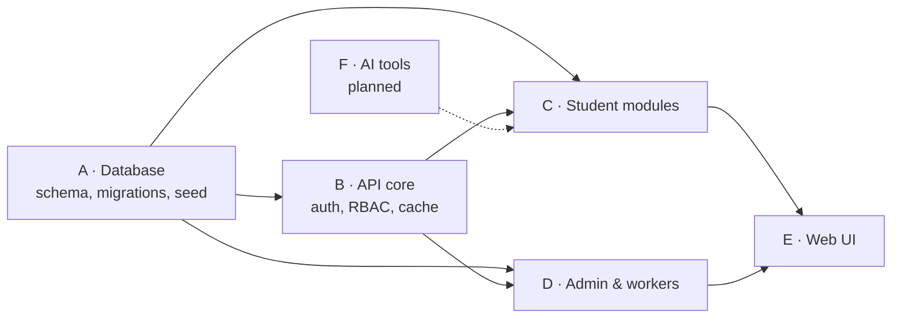

# Work streams

HigherStudy is organised into parallel streams so several people (or agents) can build at the
same time without blocking each other. Each stream owns a set of folders and talks to the others
only through the contracts listed below. A change to a contract needs a heads-up to every
stream that consumes it.

| Stream | Owns | Status in this drop |
|---|---|---|
| **A · Database** | `apps/api/prisma/**`, `src/common/{derive,csv}.ts` | Done. Schema, 5 migrations, CSV seed with validation report (shared row parsers) |
| **B · API core** | `apps/api/src/common/**`, `main.ts`, `app.module.ts` | Done. JWT, Roles/Plan guards, Redis cache-aside, audit log, mailer |
| **C · Student modules** | `modules/{auth,universities,programs,professors,outreach,applications,visa,student,payments}` | Done |
| **D · Admin & workers** | `modules/{admin,imports}`, `workers/**`, `worker.ts` | Done, incl. CSV import with preview/confirm |
| **E · Web UI** | `apps/web/**` | Done for every screen listed in the README; softer design system, first-run setup, guided tours, feature highlights |
| **F · AI tools** | new `modules/ai`, `apps/web/src/app/(app)/ai-tools` | Placeholder page only |

## Contracts between streams

**A → everyone: the Prisma schema.**
Additive changes (new optional column, new model) can land any time. Renames and removals need
a two-step migration (add new → backfill → switch readers → drop old) so streams C/D/E never see
a broken build. Raw SQL (search, CHECK constraints) lives in migrations 2 and 3. `hs_norm_tag()` in SQL
and `normTag()` in TypeScript must stay identical. Directory text fields are the source of
truth; derived columns are only ever written through `derive.ts`.

**B → C/D: guards and cache.**
- `@Public()`, `@Roles(...)`, `@RequiresPlan(...)` decorators and the `AuthUser` shape on `req.user`.
- `CacheService.wrap(key, ttl, loader)` plus the named invalidators
  (`invalidateUniversities`, `invalidateProfessors`, `invalidateStudent`, `invalidateUserRole`).
  Modules never build `hs:` keys by hand — they use `Keys.*` from `cache-keys.ts`.
- `AuditService.log(...)` for any admin-initiated mutation.
- `requireStudent(user)` is the ownership boundary: every student-scoped query filters by the
  caller's own profile id.

**C/D → E: the REST API under `/api/v1`.**
Response shapes are mirrored in `apps/web/src/lib/types.ts`. Error bodies carry a machine
`code` where the UI branches on it: `PLAN_UPGRADE_REQUIRED`, `PLAN_LIMIT`, `PROFILE_REQUIRED`.

**D ↔ C: notifications.**
Workers write `Notification` rows with a unique `dedupeKey`; the bell in the UI reads
`GET /notifications`. A new reminder type only needs a new `kind` string and a dedupe key format.

## Definition of done (per stream)

1. `npm run typecheck` passes at the root.
2. Unit tests for new guards/logic (`apps/api/src/**/*.spec.ts`).
3. `apps/api/test/smoke.sh` still passes against a freshly seeded database (70 checks today).
4. Any new cached read has a matching invalidation on every write path.
5. Any admin mutation writes an `AdminActionLog` row.

## Suggested next tasks per stream

- **A:** restore the columns the spreadsheet export lost (docs/DATA_NOTES.md), then turn on `SEED_STRICT=1` in CI.
- **B:** refresh tokens + httpOnly cookie session (the web currently keeps a 1-day JWT in localStorage).
- **C:** file uploads for CV / proposal attachments (S3-compatible storage); Nagad signing.
- **D:** user import with invite emails (no passwords in CSV); weekly digest email; Bull Board for queue visibility.
- **E:** dark mode, Playwright regression suite built from `docs/screenshots`.
- **F:** cold-email drafter and SOP reviewer behind the plan guard (Standard/Advanced tiers).
